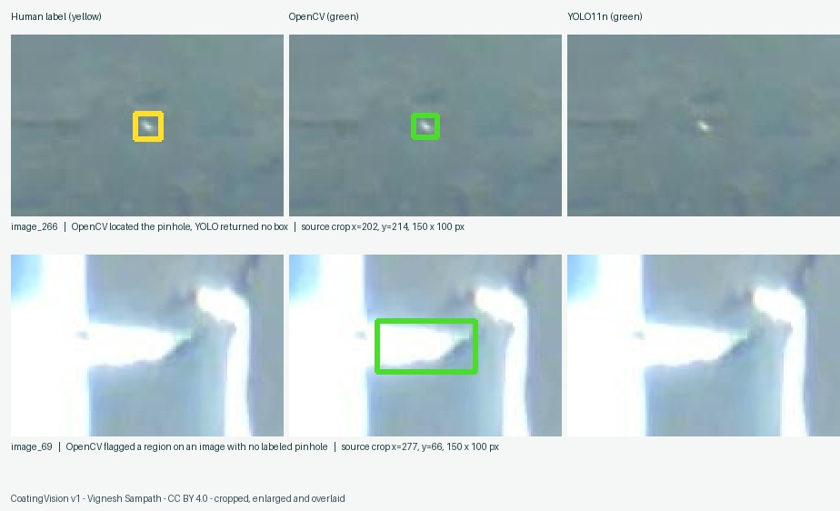

# 电极涂布表面针孔定位与端侧部署

这个工业视觉原型从一张 640 × 480 的涂布照片中找出疑似针孔，返回原图坐标和置信度，供人工复核。项目比较 OpenCV 形态学检测与 YOLO11n，在 Windows x64 上用 C++17 和 ONNX Runtime 运行 CPU 推理，并用文件相机和模拟 PLC 检查异常处理。



第一张图里，OpenCV 找到人工标注的针孔，YOLO11n 漏检。第二张图没有针孔标注，OpenCV 给出三个候选框。示例由 CoatingVision v1 图像裁切、叠框并拼接而成。[两张图的样本编号与裁切坐标](docs/examples/comparison.json) · [原始数据](https://doi.org/10.6084/m9.figshare.29260121.v1)

## 检测结果

从公开涂布实验数据筛选 2,149 张有明确针孔标记的图像，按采集序列划分训练、验证和测试集，同一帧的图块保留在同一集合。留出的两个采集序列共 423 张图、60 个标注针孔。工作阈值在验证集按 F1 选择，测试时按 IoU ≥ 0.50 一对一匹配检测框。[划分记录](reports/dataset-split.json) · [阈值记录](reports/operating-point.json) · [分序列评估](reports/test.json)

| 留出测试 | 检出 | 漏检 | 误报框 | 精确率 | 召回率 | F1 |
| --- | ---: | ---: | ---: | ---: | ---: | ---: |
| OpenCV 白顶帽与连通域 | 44 | 16 | 84 | 34.4% | 73.3% | 0.468 |
| YOLO11n ONNX | 40 | 20 | 3 | 93.0% | 66.7% | 0.777 |

在 25 个面积小于 256 平方像素的小针孔中，OpenCV 检出 21 个，YOLO11n 检出 13 个。演示选用误报较少的 YOLO11n，保留疑似缺陷的位置供复核。结果来自公开实验图块，应用到生产线时需针对实际材料、照明和相机重新验证。

## 推理和工位

- **Windows CPU 推理**使用 Windows Imaging Component 解码文件，做等比缩放、填边与归一化，推理后执行单类 NMS 并还原坐标。32 张验证图上，C++ 与 Python 的输出框数逐张一致，最大坐标差小于 0.001 像素。[C++ 源码](native/main.cpp) · [一致性报告](reports/native-parity.json)
- **单帧耗时**在 i7-12700H 上用 Python 调用 ONNX Runtime，预热后对 64 张已解码图像各测试 3 次。YOLO11n 的预处理、推理与后处理总耗时 P50 为 31.98 ms，P95 为 33.37 ms。相机采集、读盘和通信在计时范围之外。[逐轮计时](reports/timing.json)
- **软件在环仿真**按触发 ID 关联图像和应答。重复触发只产生一个结果，缺帧转人工复核，应答超时进入挂起状态。下载仓库后，在浏览器中打开回放文件即可逐步查看六个触发记录和检测叠框。[离线回放文件](docs/replay/replay.html) · [事件剧本](simulation/scenario.json) · [事件记录](reports/cell-trace.json)

## 复现

以下命令在 Windows PowerShell 和 Python 3.10 x64 环境中运行。图像和初始权重由脚本分别从 Figshare 和 Ultralytics 下载并校验。先在仓库根目录创建环境，以 CPU 方式安装。训练也可按 PyTorch 对应版本的说明使用 CUDA。[PyTorch 版本与安装索引](https://pytorch.org/get-started/previous-versions/)

```powershell
py -3.10 -m venv .venv
$py = '.\.venv\Scripts\python.exe'
& $py -m pip install torch==2.5.1 torchvision==0.20.1 --index-url https://download.pytorch.org/whl/cpu
& $py -m pip install -r requirements.txt
& $py fetch_assets.py data
& $py prepare_data.py
& $py -m unittest discover -s tests -v
```

查看标注、训练模型、评估并生成工位回放。运行结果写入本地 `runs` 目录。

```powershell
& $py lesson_01_boxes.py --id image_1011
& $py baseline.py
& $py fetch_assets.py weights
& $py train_yolo.py
& $py evaluate.py
& $py detect.py data/prepared-v1/images/val/image_994.jpg
& $py simulate_cell.py
```

原生部署使用 Visual Studio 2022 的桌面 C++ 工作负载、CMake 与 Windows SDK。先完成上述训练和评估，再编译并核对部署结果。最后一个命令逐张比对 PyTorch、ONNX 与 C++ 的输出，并生成可解压运行的 Windows x64 演示包。

```powershell
& $py native/fetch_sdk.py
& .\native\build.ps1
& $py verify_native.py
```

## 数据与署名

CoatingVision v1 的发布者为 Vignesh Sampath。仓库展示图及回放中的图像在原图基础上进行了裁切、缩放、叠框或拼接，示例图沿用 CC BY 4.0。原始数据、训练初始权重与 ONNX Runtime SDK 由各自的获取脚本下载。[CoatingVision v1](https://doi.org/10.6084/m9.figshare.29260121.v1) · [CC BY 4.0](https://creativecommons.org/licenses/by/4.0/) · [Ultralytics YOLO11 权重](https://huggingface.co/Ultralytics/YOLO11) · [Ultralytics 许可](https://www.ultralytics.com/license) · [ONNX Runtime](https://github.com/microsoft/onnxruntime)
